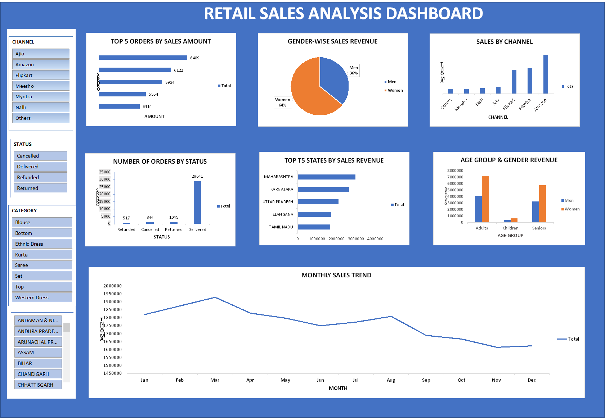

# Retail Sales Analysis Dashboard

## Project Overview
Developed an interactive Excel Sales Dashboard to analyze order performance, customer demographics, sales trends, and geographical distribution. The dashboard provides management with key insights into sales performance, customer behavior, and operational efficiency.

## Key Features & Deliverables
- **Interactive Excel Dashboard:** Designed a user-friendly layout suitable for management reporting.
- **Pivot Tables & Charts:** Built to aggregate data dynamically.
- **Slicers for Filtering:** Integrated interactive slicers (Channel, Category, Status, etc.) for real-time data drilling.
- **Automated KPI Calculations:** Cleaned and mapped raw metrics to clear visual objects.

## Key Performance Indicators (KPIs) Tracked
1. Top 5 Orders by Sales Amount
2. Gender-wise Sales Revenue
3. Sales by Channel
4. Number of Orders by Status
5. Top 5 States by Sales Revenue
6. Age Group and Gender-wise Revenue Analysis
7. Monthly Sales Trend

## Data Pipeline Architecture
The project file is organized into operational layers to ensure data integrity:
- `Raw Data`: The baseline transaction records.
- `Clean Data`: Processed and standardized dataset used for analysis.
- `Dashboard`: The final interactive presentation interface.

 ## Preview

